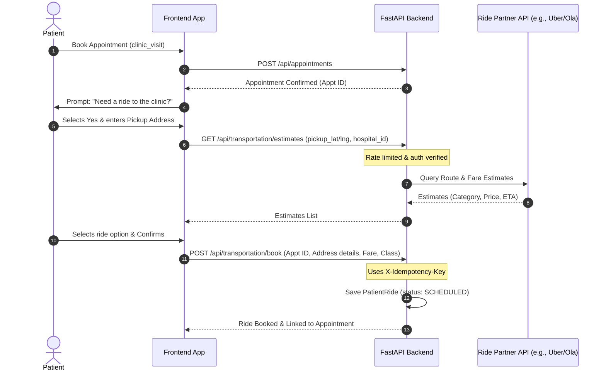

# Patient Transportation Integration Plan (Architect Reviewed)

This document outlines the system architecture, database schema, API designs, lifecycle states, and frontend flows for integrating patient transportation (cabs/medical rides) for clinic or hospital visits.

---

## 1. Core User Flow (Decoupled Architecture)

To ensure appointment bookings are not blocked by third-party transportation API failures, the ride booking flow is fully decoupled from the core appointment creation transaction.



---

## 2. Frontend Screen Implementations (User Experience)

### Screen A: Checkout Page Integration (`PaymentPage.tsx`)

For in-person appointments (`appointmentMode === 'clinic_visit'`), the ride selection card is presented as a post-booking confirmation or optional step during checkout.

#### Leveraging Saved Patient Addresses
- **Default Fill:** Automatically selects the patient's default saved address (`is_default`) as the pickup location.
- **Dropdown List:** Renders saved locations (e.g., "Home", "Work") for fast selection.
- **Precision Coordinates:** Transmits stored `latitude` and `longitude` to eliminate geocoding failures.

```typescript
// Proposed UI State
const [needRide, setNeedRide] = useState(false);
const [savedAddresses, setSavedAddresses] = useState<PatientAddress[]>([]);
const [selectedAddressId, setSelectedAddressId] = useState<string>('');
const [selectedRideOption, setSelectedRideOption] = useState<string | null>(null);
const [estimates, setEstimates] = useState<RideEstimate[]>([]);
const [estimatesLoading, setEstimatesLoading] = useState(false);
const [isReturnRideRequested, setIsReturnRideRequested] = useState(false);
```

#### UI Layout Mockup:
```
+-------------------------------------------------------------+
|  [🚗 Icon] Add a Ride to the Clinic?                        |
|  Get picked up from your home and dropped at the hospital.   |
|                                         [Toggle: ON / OFF]  |
|                                                             |
|  (If toggled ON)                                            |
|  * Pickup Address:                                          |
|    [ Select Saved Address: Home (123 Main St)           [v] ] |
|    ( ) Use a different address                              |
|                                                             |
|  * Select Vehicle Class:                                    |
|    ( ) Hatchback (ETA: 5 mins)                     ₹150.00  |
|    (*) Comfort Sedan (ETA: 7 mins)                 ₹240.00  |
|    ( ) Medical Wheelchair Accessible Cab           ₹380.00  |
|                                                             |
|  [ ] Book return ride back to pickup address after visit    |
+-------------------------------------------------------------+
```

---

### Screen B: Patient Appointment Detail Page (`PatientAppointmentDetailPage.tsx`)

A unified transportation tracking widget renders below "Consultation Details" if `appointment_mode === 'clinic_visit'` and a ride is associated.

- **Status Banner:** Dynamically renders states: `SCHEDULED`, `DISPATCHED`, `IN_TRANSIT`, `COMPLETED`, `FAILED_TO_DISPATCH`, or `CANCELLED`.
- **Driver Card:** Displays driver name, vehicle plate numbers, contact numbers, and rating.
- **Rebook Trigger:** If status is `FAILED_TO_DISPATCH` or `CANCELLED`, provides an immediate rebook CTA.

---

## 3. Database Schema

We add `PatientRide` and `RideStatusLog` to the database, utilizing indexes and snapshot patterns to ensure performance and auditing compliance.

### `PatientRide` Model
Tracks the lifecycle of the ride linked to an appointment. Pickup/dropoff addresses are snapshotted to preserve historical audit data even if saved user profiles or hospital locations change.

| Column | Type | Constraints | Description |
| :--- | :--- | :--- | :--- |
| `id` | `INT` | `PK, Autoincrement` | Database primary key. |
| `public_id` | `VARCHAR(36)` | `Unique, Index` | Public identifier (UUID). |
| `appointment_id` | `INT` | `FK, Index` | Link to `appointments.id`. |
| `patient_address_id` | `INT` | `FK, Nullable` | Optional link to address book. |
| `pickup_address` | `TEXT` | `NotNull` | Snapshot of pickup location text. |
| `pickup_lat` | `DECIMAL(9, 6)` | `NotNull` | Latitude of pickup point. |
| `pickup_lng` | `DECIMAL(9, 6)` | `NotNull` | Longitude of pickup point. |
| `dropoff_address` | `TEXT` | `NotNull` | Snapshot of hospital address text. |
| `dropoff_lat` | `DECIMAL(9, 6)` | `NotNull` | Latitude of hospital. |
| `dropoff_lng` | `DECIMAL(9, 6)` | `NotNull` | Longitude of hospital. |
| `ride_provider` | `VARCHAR(50)` | `NotNull` | E.g., `uber`, `ola`, `med_cabs`. |
| `provider_ride_id` | `VARCHAR(100)` | `Index, Nullable` | Reference ID from the partner. |
| `vehicle_type` | `VARCHAR(50)` | `NotNull` | Vehicle class requested. |
| `status` | `VARCHAR(30)` | `Index, NotNull` | State machine status code. |
| `estimated_fare` | `DECIMAL(10, 2)` | `NotNull` | Fare quote at booking. |
| `actual_fare` | `DECIMAL(10, 2)` | `Nullable` | Final fare billed by partner. |
| `currency` | `VARCHAR(3)` | `NotNull, Default='INR'`| ISO currency code. |
| `driver_name` | `VARCHAR(100)` | `Nullable` | Driver name. |
| `driver_phone` | `VARCHAR(20)` | `Nullable` | Driver phone. |
| `vehicle_number` | `VARCHAR(30)` | `Nullable` | License plate. |
| `is_return_ride` | `BOOLEAN` | `Default=False` | True if ride is for hospital-to-home. |
| `parent_ride_id` | `INT` | `FK, Nullable` | Self-reference linking return to onward ride. |

**Indexes Required:**
*   `CREATE INDEX idx_rides_appt_id ON patient_rides(appointment_id);`
*   `CREATE INDEX idx_rides_status ON patient_rides(status);`
*   `CREATE INDEX idx_rides_provider_id ON patient_rides(provider_ride_id);`

---

## 4. API Endpoints

### Internal Endpoints

#### 1. `GET /api/transportation/estimates`
Fetches fare and ETA quotes.
- **Authentication:** Required.
- **Rate Limiting:** IP-based and User-based token bucket (max 10 calls per minute per user).
- **Request Headers:**
  - `Authorization: Bearer <token>`
- **Response:**
  ```json
  {
    "success": true,
    "data": {
      "options": [
        {
          "type": "economy",
          "label": "Budget Ride (Sedan)",
          "estimated_price": 250.00,
          "currency": "INR",
          "eta_minutes": 8
        }
      ]
    }
  }
  ```

#### 2. `POST /api/transportation/book`
Schedules a ride.
- **Headers:**
  - `X-Idempotency-Key`: UUID (Required to prevent duplicate cab orders).
- **Request Body:**
  ```json
  {
    "appointment_id": "appt_pub_id_123",
    "patient_address_id": "addr_pub_id_456",
    "vehicle_type": "economy",
    "estimated_fare": 250.00,
    "is_return_ride": false
  }
  ```

#### 3. `POST /api/transportation/webhooks/status`
Public endpoint accepting partner webhook updates.
- **Security Check:** Validates HMAC-SHA256 signature passed in the header (e.g., `X-Provider-Signature`) using a pre-shared secret.
- **Webhook Deduplication:** Checks request ID against a Redis cache before processing.

---

## 5. Ride Lifecycle & Robust State Machine

The ride state transitions must enforce strict validation rules.

```
       +-------------[ SCHEDULED ]-------------+
       |                                       |
       v                                       v
 [ REQUESTING ]                          [ CANCELLED ]
       |
       v
 [ DISPATCHED ] -----------> [ FAILED_TO_DISPATCH ]
       |
       v
  [ IN_TRANSIT ] -----------> [ DRIVER_NO_SHOW ]
       |
       v
  [ COMPLETED ] -----------> [ ABANDONED ]
```

- **Transitions Enforcement:** Once a ride reaches `COMPLETED`, `CANCELLED`, or `FAILED_TO_DISPATCH`, it cannot transition to any other status.
- **Audit Logs:** Every transition creates an entry in `RideStatusLog` containing the partner's raw webhook JSON payload.

---

## 6. External Cron Trigger Architecture (Established Pattern Alignment)

Since the current codebase does not run a persistent task scheduler (like Celery beat or APScheduler) and is designed for serverless/stateless deployment, we will follow the **established pattern used by the follow-ups module (`process_followup_reminders`)**:

1. **Secure Admin Dispatch Trigger Endpoint:**
   - Expose a POST route: `POST /api/transportation/process-dispatches`.
   - Accessible only by secure external schedulers or triggers (e.g., AWS EventBridge, Cloud Scheduler, or cron jobs).
   - This endpoint is invoked periodically (e.g., every 5 or 10 minutes).

2. **Dispatcher Execution Logic:**
   - When triggered, the backend queries the database for all `SCHEDULED` rides linked to appointments starting in the next `45 to 60 minutes`.
   - For each matching ride:
     - Check if the appointment status is still valid (not cancelled or rescheduled).
     - Fire a POST request to the Ride Partner API to request vehicle dispatch.
     - Update the ride status from `SCHEDULED` to `REQUESTING`.
     - Log the transition in `RideStatusLog`.

3. **Advantages:**
   - **Zero Extra Infrastructure:** Avoids adding dependencies like Redis, RabbitMQ, SQS, or running separate Celery worker processes.
   - **Stateless Server Architecture:** Keeps the FastAPI backend lightweight, stateless, and fully compatible with serverless runtimes.


---

## 7. Resilience, Edge Cases & Pricing Guardrails

- **Surge Pricing Caps:** Estimates lock a fare quote. If the actual fare requested by the driver at dispatch exceeds estimate by >25%, the system pays up to a maximum limit, otherwise it requests patient confirmation via SMS/push.
- **Rescheduling / Cancellations:** If an appointment is cancelled, we check the ride status. If the status is `DISPATCHED` or `IN_TRANSIT`, we call the partner API to cancel the ride (and account for cancellation fee logging).
- **Accessibility Requirements:** The database `PatientRide` schema stores custom accessibility keys (e.g., `wheelchair_required`), which are passed to the partner's dispatch endpoints.
